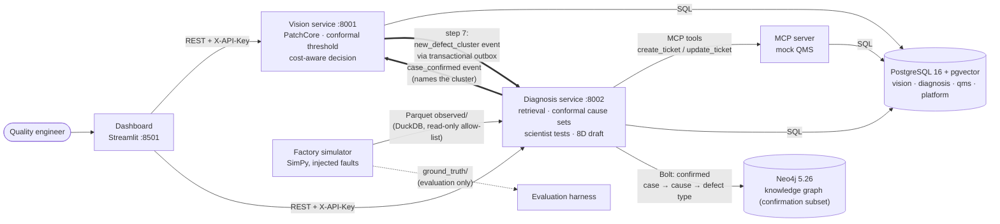

# Industrial Quality AI Engineering System

[](https://github.com/preethi834/industrial-quality-system/actions/workflows/ci.yml)
[](https://github.com/preethi834/industrial-quality-system/actions/workflows/docker.yml)

A quality-engineering platform for a production line, built as two connected services. The **vision
service** inspects part images with an anomaly detector that only needs images of good parts. Its
false-alarm rate has a statistical bound, and it chooses accept, reject or send-to-review by
expected cost. The **diagnosis service** takes a quality alarm and finds likely root causes. It
retrieves similar past cases and returns a *conformal set* of causes, so the engineer knows how
much to trust it. It then tests each candidate cause against process data and drafts an 8D report.
In a factory this targets three costs: good parts scrapped because of false alarms, defects
shipped to customers, and engineer hours spent on root-cause analysis. Every number below comes
from a script and is logged in MLflow, and the limits of each result are written down next to it.

> **Status:** Steps 0–7 done and merged (tags `v0.1-step0`, `v0.1-step1`, `v0.1-step2`,
> `v0.2-steps3-5`, `v0.1-step6`, `v0.1-step7`). Step 7, the integrated quality loop, works end
> to end on the Docker stack; its false-cluster risk on real images is open (#46). All diagnosis
> results come from simulator data.

## Architecture



More detail: [docs/ARCHITECTURE.md](docs/ARCHITECTURE.md). Design decisions are recorded as
ADRs in [docs/TECHNICAL_DECISIONS.md](docs/TECHNICAL_DECISIONS.md).

## Key results

Only measured numbers. Each row links to its entry in [EXPERIMENTS.md](docs/EXPERIMENTS.md),
which lists the command, data manifest, seed and MLflow run IDs; the `dx_corpus_v2` comparison is
recorded in the step-3 notes. The **Data** column says what a number rests on.

| Result | Number | Data | Source |
| --- | --- | --- | --- |
| PatchCore anomaly detection, CPU only, 15 categories | image AUROC **0.984** (published 0.980), pixel AUROC **0.982**; 14/15 within ±0.02 of published, the outlier investigated | Benchmark images (MVTec AD) | [EXP-1-01](docs/EXPERIMENTS.md#exp-1-01--patchcore-on-mvtec-ad-vs-anomalibs-published-numbers-done) |
| Same images vs a supervised ResNet-18 | PatchCore 0.977 vs supervised 0.849 mean AUROC; PatchCore needs no defect labels | Benchmark images (MVTec AD) | [EXP-1-02](docs/EXPERIMENTS.md#exp-1-02--supervised-resnet-18-vs-patchcore-on-the-same-sup_test-images-done) |
| Inspection latency, dockerised API | p50 **529 ms**, p95 **560 ms** (CPU, sequential) | Benchmark images | [EXP-1-03](docs/EXPERIMENTS.md#exp-1-03--inspection-latency-through-the-dockerised-api-done) |
| Harder datasets, same pipeline | image AUROC 0.975 / 0.989 (VisA), 0.960 / 0.920 (MVTec AD 2, regular lighting) | Benchmark images (VisA, MVTec AD 2) | [EXP-2-01](docs/EXPERIMENTS.md#exp-2-01--patchcore-on-visa-and-mvtec-ad-2-deploy-protocol-done) |
| Conformal false-alarm bound | validity check passes in **19/19** categories (100 resplits, mean FA ≤ α + 3 SE) | Benchmark images | [EXP-2-02](docs/EXPERIMENTS.md#exp-2-02--realised-false-alarm-rate-of-the-conformal-threshold-done) |
| Lighting shift stress test | synthetic shifts push FA from ≤ 5 % to as high as 88 % (screw, cool tint) → recalibrate after camera or lighting changes | Benchmark images, synthetic shifts | [EXP-2-03](docs/EXPERIMENTS.md#exp-2-03--in-distribution-threshold-under-lighting-shift-done) |
| Cost-aware accept / reject / review | €3,405 vs €7,547 per 10,000 parts against a fixed threshold (17 categories); realised FA 0.028 | Benchmark images + **assumed** costs and 1 % defect rate | [EXP-6-01](docs/EXPERIMENTS.md#exp-6-01--cost-aware-accept--reject--review-vs-fixed-threshold-done-assumed-costs) |
| Root-cause top-1 accuracy, known causes | harder corpus (`dx_corpus_v2`, dev split, 449 cases): hybrid retrieval **0.927** vs BM25 alone 0.898 vs feature vector alone 0.911. The easy corpus (`dx_corpus_v1`, test split) is solved by the feature vector alone (1.000) | Simulator data | [step-3 notes](docs/notes/step-3.md#dx_corpus_v2--harder-corpus-for-step-4), [EXP-3-02](docs/EXPERIMENTS.md#exp-3-02--diagnosis-agent-on-simulator-cases-dx_corpus_v1-test-split-done-simulator-only) |
| Conformal cause sets, α = 0.1 | coverage APS **0.989** (avg. size 1.56), LAC 0.894 (size 0.96) | Simulator data | [EXP-4-01](docs/EXPERIMENTS.md#exp-4-01--conformal-cause-sets-on-dx_corpus_v2-done-simulator-only) |
| Scientist hypothesis tests | null false-positive rate ≤ 0.053 over 1,000 fault-free runs; correct cause supported 0.957 | Simulator data | [EXP-5-01](docs/EXPERIMENTS.md#exp-5-01--scientist-agent-null-check-power-and-sci_eval_v1-done-simulator-only) |
| Integrated quality loop, end to end on the Docker stack | median **2.7–3.4 s** from the first anomalous image to an opened diagnosis case (3 runs × 5 repeats); all events processed, one case per cluster even on redelivery, cluster named after confirmation | Simulator data + synthetic images and image-to-part linkage; plumbing only, no detection-quality claim | [step-7 notes](docs/notes/step-7.md#measured-in-7g-compose-e2e-gate-1-plumbing-not-a-quality-result) |

The euro figures are not plant savings. On the 14 categories where the false-alarm guarantee is
claimed, the saving interval includes zero (KNOWN_ISSUES #33). The simulator task was designed to
be solvable, so its accuracy says nothing about real plants (#18).

## Engineering highlights

- **Statistical guarantees, checked empirically.** A split-conformal threshold bounds the
  false-alarm rate. It comes with Clopper–Pearson intervals, a Beta-binomial prediction, and a
  refusal when the calibration set is too small for the requested α. Cause sets use LAC and APS.
  The cost policy keeps the false-alarm guarantee by construction (ADR-010, ADR-011).
- **Leak guards.** Split manifests hold a SHA-256 per image, and overlap is checked by path and
  by content. Only `iqs_diagnosis.evaluation` may read simulator ground truth, which an AST test
  enforces. The probability fit is kept separate from the calibration and test sets
  (`DecisionLeakageError`). Evaluation families are committed before their runs.
- **Safe data access for the agent.** The agent reads process data through DuckDB with a
  read-only allow-list, external access off and the configuration locked (ADR-008). It can change
  "factory systems" only through MCP tools.
- **Idempotency.** Cross-service events go through a transactional outbox whose primary key is
  `event_id`, so a duplicate insert fails instead of being delivered twice. Creating a QMS ticket
  is idempotent per case, so a re-run of the agent never opens a second ticket.
- **CI and reproducibility.** On every push GitHub Actions runs the pre-commit hooks (ruff, mypy,
  detect-secrets, a uv.lock check), the unit and API tests, and integration tests. A separate
  workflow builds the images, starts the stack and smoke-tests it. Actions are pinned by SHA,
  images by digest, and tool versions come from `uv.lock`. The last full `make check` run passed
  664 tests (2026-11-22).
- **Real databases in tests.** Integration tests use testcontainers to start the same pinned
  Postgres + pgvector and Neo4j images as the compose stack.
- **Known issues are recorded.** [KNOWN_ISSUES.md](docs/KNOWN_ISSUES.md) lists failed gates,
  borderline margins and results that do not transfer, each with its impact and next action.

## Tech stack

Python 3.11 · uv workspace · FastAPI · PyTorch + anomalib (PatchCore) · LangGraph (Postgres
checkpointer) · MCP · SimPy · DuckDB / Parquet · PostgreSQL 16 + pgvector · Neo4j 5.26 ·
SQLAlchemy 2 + Alembic · MLflow · Streamlit · Docker Compose · GitHub Actions · pytest,
hypothesis, testcontainers · ruff, mypy, pre-commit

## Quickstart

Needs Linux or WSL2, Docker and [uv](https://docs.astral.sh/uv/).

```bash
make setup                        # uv sync --all-packages --frozen
cp .env.example .env              # set the passwords and IQS_API__KEYS
make up                           # Postgres (127.0.0.1:5433) + Neo4j, waits until healthy
make db-migrate                   # Alembic migrations
make check                        # pre-commit hooks + unit/API tests (what CI runs)

make build && make up PROFILES=apps   # + vision :8001, diagnosis :8002, dashboard :8501
make smoke                            # /health, /ready, API key check
make down                             # stop containers, keep volumes
```

Run `make help` to list all targets. Model weights and datasets are never downloaded at runtime.
They are listed in `configs/assets.yaml` and fetched only by explicit scripts, so a fresh
checkout serves no trained models until you train or import them.

## Repository layout

```text
packages/
  common/       iqs_common: settings, logging, DB, IDs, taxonomy, events, outbox, HTTP plumbing
  vision/       iqs_vision: datasets, PatchCore, conformal, cost decisions, API
  diagnosis/    iqs_diagnosis: symptoms, retrieval, conformal, scientist, agent, 8D, API
  simulator/    iqs_sim: SimPy factory line, faults, Parquet export
  mcp_server/   iqs_mcp: mock QMS over MCP
  dashboard/    iqs_dashboard: Streamlit UI (talks only to the APIs)
configs/        model, cost, taxonomy and asset configs
eval_sets/      committed split manifests (SHA-256 per item)
scripts/        training, calibration, evaluation and benchmark entry points
reports/        generated result reports and figures
infrastructure/ Alembic migrations
deploy/         Dockerfiles and compose
tests/          config, integration (testcontainers) and e2e tests
docs/           architecture, ADRs, experiments, testing, known issues, step notes
```

## Roadmap

| Step | Scope | Status |
| --- | --- | --- |
| 0 | Foundation: settings, databases, service skeletons, CI | done |
| 1 | Defect detector (PatchCore + supervised baseline), inspection API, dashboard | done (EfficientAD deferred, #15) |
| 2 | VisA / MVTec AD 2, conformal false-alarm threshold, shift experiment | done |
| 3 | Diagnosis agent: hybrid retrieval, novelty, MCP tickets, 8D | done on simulator cases; LLM gateway, dense retrieval and Neo4j graph planned |
| 4 | Conformal cause sets | done on simulator cases; coverage on a real test split open (#19) |
| 5 | Factory simulator + scientist agent | done |
| 6 | Cost-aware accept / reject / review | done |
| 7 | Integrated quality loop: vision event → diagnosis case | done: loop works end to end, e2e test on Docker; false-cluster risk on real images open (#46) |
| 8 | Advanced features | planned |
| 9 | Public benchmark release and report | planned |

Detailed checklist: [docs/IMPLEMENTATION_PLAN.md](docs/IMPLEMENTATION_PLAN.md).

## Limitations

The main ones, all tracked in [docs/KNOWN_ISSUES.md](docs/KNOWN_ISSUES.md):

- **Diagnosis results are simulator results** (#18). There is no LLM yet, so text-only cases
  (NHTSA) cannot be diagnosed (#20). Real-data coverage of the cause sets is still untested (#19).
- **Vision results come from public benchmark images**, not a production line. In some MVTec AD
  categories the train and test good images are not exchangeable, so the fixed-split false-alarm
  rate fails there (#17).
- **The false-alarm guarantee does not survive capture changes** (EXP-2-03), and at α = 0.02 the
  miss rate is high on the hard categories (#29).
- **Cost results use assumed euro values.** On the guaranteed subset the saving interval includes
  zero (#33, #34).
- **LAC cause sets pass their gate by a 0.002 margin** and miss two-fault cases (#22). The novelty
  threshold does not transfer between corpora (#21).
- **The new-defect trigger fires on false alarms with real images** (#46). On MVTec AD metal_nut,
  5 of 66 unseen good images score above the threshold and form one compact cluster, which opens
  a bogus case; in the tool-wear demo 5 of the 6 images behind the alert are good parts. The loop
  itself works; choosing a review band or cluster rule without tuning on these runs is step 8c.
- **Not built yet:** the full Neo4j graph schema (step 7 writes only confirmed cases, causes and
  defect types) and an EfficientAD run (#15).

## License

The code is released under the [MIT License](LICENSE) (copyright 2026 Preethi Mannaru).

The datasets are **not** included and keep their own licenses: MVTec AD and MVTec AD 2
(CC BY-NC-SA 4.0, non-commercial), VisA (CC BY 4.0) and the NHTSA recalls file (U.S. government
work, public domain). Download them yourself under those terms; `configs/assets.yaml` lists the
sources. The repository holds only split manifests (file names and hashes, no images) and a
50-row labelled sample of NHTSA recall text (`eval_sets/diagnosis/nhtsa/`).
